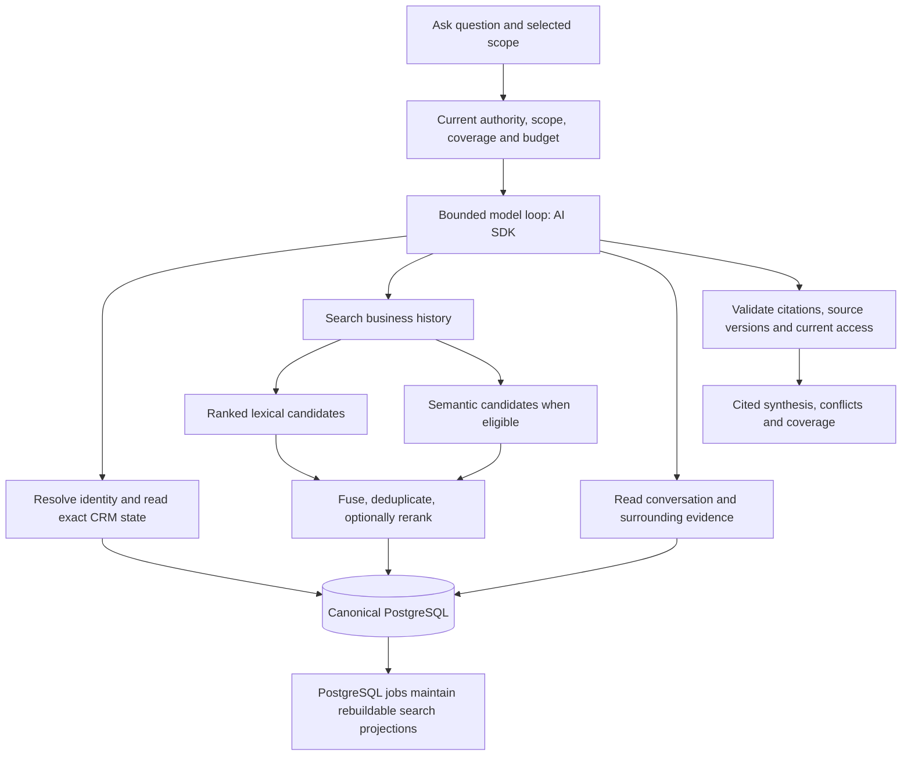

# Callie Ask: deep architecture research and recommendation

Research date: October 10, 2026, America/New_York. Source inspection at `200d49be`; this is research, not a new ADR, implementation, release or activation. The manually driven three-approach prototype is not empirical architecture evidence. No experiment, model/embedding call, package installation or production operation was performed for this research.

## Decision we can make from existing evidence

**Build Ask around one bounded model-led read loop, PostgreSQL-backed exact state and hybrid retrieval, with conversation expansion. Prefer AI SDK as the reusable TypeScript runtime; retain Pi agent core as the close alternative.**

This is an engineering recommendation combining published evidence and implementation fit. It is not a claim of a universal best architecture or a measured Callie latency/accuracy result. Research is sufficient to choose this direction now; a homemade tournament or a collection of private customer threads is not a prerequisite. Later acceptance should verify the chosen implementation's correctness, quality and performance.

Keep the approved existing stack and PostgreSQL jobs. Semantic retrieval fits the approved bounded hybrid-search direction; its production extension/model availability and quality remain unverified. Do not introduce a separate vector database, generated knowledge graph or multi-agent service merely to enable Ask.

## Research questions and method

Three parallel investigations examined primary papers, official documentation and immutable implementation revisions:

1. What do experiments establish about full context, one-shot retrieval and adaptive search/read? Which task, model, baseline and scoring limitations matter?
2. Which existing harness can supply the loop in our TypeScript/Bedrock worker without replacing evidence, usage and permission contracts?
3. How do mature retrieval products implement hybrid search, conversation context, permission filters, ingestion and deletion? What is actually measured?

Supporting reports contain detailed source links, commits, numerical tables and caveats:

- [Paper evidence](ask-architecture-paper-evidence-20261010.md): ten source families including A-RAG, FRAMES, LongMemEval, Harness-Bench, Self-Route, Self-RAG, CRAG, FLARE and LoCoMo.
- [Harness adoption](ask-harness-adoption-research-20261010.md): AI SDK, Pi, Hermes, LangGraph, Deep Agents and smolagents.
- [Retrieval implementations](ask-retrieval-implementation-research-20261010.md): Onyx, LlamaIndex, PostgreSQL/pgvector, BEIR, BRIGHT, GraphRAG and LightRAG.

Papers supply task-specific experimental evidence. Documentation establishes supported interfaces; inspected code establishes behavior at a revision. Neither documentation nor code inspection is a performance measurement. The recommendations below are our inference across those sources. Secondary vendor comparisons, social posts and framework popularity were not accepted as evidence of a winner.

## What the evidence says

**Adaptive retrieval is a credible default for questions whose evidence location is unknown.** A-RAG exposes keyword search, semantic search and a separate chunk read to a model. Its multi-hop QA comparisons support progressive access and model-directed follow-up. Its retrieved-token savings are not total model cost or end-to-end latency. We should borrow the interface pattern, not transfer its headline score to CRM. [A-RAG paper](https://arxiv.org/html/2602.03442v1)

**Long context and retrieval are complementary.** Self-Route and a later cross-dataset comparison find strong long-context results overall, while the latter's dialogue subset favors retrieval. Therefore a selected conversation can go directly into context; a cross-firm question should search. Sending an entire mailbox to a model is not established as optimal. [Self-Route](https://arxiv.org/html/2407.16833v2), [Long Context vs. RAG revisits](https://arxiv.org/html/2501.01880v1)

**Repeated reasoning has a real sequential cost.** FRAMES improves multi-hop retrieval answers, but its strongest tested configuration uses six non-parallelizable inference calls. Avoid prescribing a planner, rewriter, retriever, critic and summarizer for every request. Extra investigation should respond to missing evidence. [FRAMES](https://arxiv.org/html/2409.12941v2)

**Time, corrections and missing coverage deserve explicit support.** LongMemEval evaluates temporal reasoning, updates and abstention as distinct abilities. This is closer to our questions than generic document matching, although assistant chat histories still differ from email quote chains, shared addresses and commercial opportunities. [LongMemEval](https://arxiv.org/abs/2410.10813)

**Hybrid retrieval has concrete implementation evidence.** Onyx's October 1 benchmark covers 500 questions and 511,958 documents. Unquantized hybrid recall@50 is 79.28%, versus 60.65% semantic-only; native retrieval median is 170 ms and p95 269 ms. These vendor-authored measurements exclude embedding network time, reranking and generation, and are not Callie response times. Its code also demonstrates section expansion and index filtering. [Pinned benchmark](https://github.com/onyx-dot-app/onyx/blob/ab2e6bbe74d968853c67730040123b3b0878a91a/backend/onyx/document_index/opensearch/QUANTIZATION_BENCHMARK.md), [Search pipeline](https://github.com/onyx-dot-app/onyx/blob/ab2e6bbe74d968853c67730040123b3b0878a91a/backend/onyx/context/search/pipeline.py)

**A powerful model does not make the harness irrelevant.** Harness-Bench compares complete harness/model configurations and finds different outcomes and resource use. It does not isolate one causal component or prove Hermes best for business retrieval. Its v1 paper and current website describe different benchmark sizes; the supporting report keeps them separate. [Harness-Bench v1](https://arxiv.org/html/2605.27922v1)

## Proposed reference architecture

These are proposed responsibilities, not shipped tool bindings:

| Interface | Responsibility |
| --- | --- |
| Resolve relationship / read CRM state | Exact identities, historical relationships, opportunities, tasks and verified progress. Use domain SQL reads; no model-generated arbitrary SQL. |
| Search business history | Lexical and semantic discovery over the same allowed scope, date ranges and current source versions. Return dated previews and resolvable references. |
| Read conversation | Expand a hit into messages or a bounded thread, preserving speaker, direction, dates, quotes and corrections. Deduplicate already read evidence. |
| Coverage information | Explain missing capture, unavailable originals and partial history. Can be included in other tool responses rather than requiring a separate call. |
| Answer publication | Separate sourced facts, exact state and inference; disclose conflicts. Validate current references and access before publishing. Citation existence alone does not prove semantic correctness. |

For a known small thread, direct context may avoid search. For exact counts/status, return SQL-backed state. For an investigation, let the model choose additional approved reads. Application code owns scope, maximum steps/tokens/time, financial admission, cancellation and publication; the model owns the read strategy within those bounds.

## Runtime choice

**AI SDK is my first adoption choice on integration fit**, subject to published-package and provider-contract review. It supplies typed tools, streamed output, step controls and a Bedrock provider in our language. It does not require Vercel hosting. Configure a small explicit step bound and disable automatic provider retries where acceptance is ambiguous; inspected core defaults include two retries. Lifecycle callbacks do not replace our durable per-call financial admission/settlement. [Tool loop](https://ai-sdk.dev/docs/reference/ai-sdk-core/tool-loop-agent), [Bedrock provider](https://ai-sdk.dev/providers/ai-sdk-providers/amazon-bedrock), [Pinned retry implementation](https://github.com/vercel/ai/blob/ba05943b69ad070558bb5bc912da99ec66d7d263/packages/ai/src/util/prepare-retries.ts)

**Pi is the close alternative** when custom loop/provider control is more important. Current `@earendil-works/pi-agent-core` offers hooks, abort and a host-supplied provider boundary. Its default Bedrock path has caching/retry details needing adaptation. **LangGraph** becomes appropriate if we need durable resumable multi-stage Ask workflows; checkpoint deletion alone does not erase separate stores or derived source copies. **Hermes** supports Bedrock and offers valuable context/history patterns, but wholesale adoption adds a Python assistant lifecycle and separate memory stores. Deep Agents and smolagents offer broader execution surfaces than this Ask workload currently needs. See the pinned comparisons in the harness report.

No source supplies a controlled Callie runtime speed comparison. This choice concerns language, provider, interface and lifecycle fit, not a claimed accuracy winner.

## Retrieval and performance choices

- Keep ingestion, extraction and embedding/index maintenance asynchronous through existing jobs; avoid reparsing all history during an Ask request.
- Run independent lexical and semantic candidate queries in parallel, with consistent scope; combine ranks and expand relevant conversation context. Reranking is optional, not an unconditional extra provider call.
- Native PostgreSQL ranking is not BM25. Start with its supported ranked full-text functionality; adopt an additional lexical engine only if justified. pgvector supports rank fusion and exact search; filtered approximate indexes can underfill results. Small scoped corpora do not require ANN immediately. [PostgreSQL ranking](https://www.postgresql.org/docs/current/textsearch-controls.html), [pgvector](https://github.com/pgvector/pgvector/blob/f37c13f68b57d2c3472b2214fbcff699d6d34876/README.md)
- Stream visible progress. Provisional generated text must not be treated as a validated persisted answer. Track time to first useful result separately from complete answer time.
- Measure retrieval, provider calls, context size, loop depth and final validation separately. This identifies a bottleneck without incorrectly attributing embedding/model delays to SQL.
- Cache only with source/access-version dependency keys and deletion invalidation. Provider prompt caching needs explicit usage-accounting support before enabling it.

Full Onyx adoption adds OpenSearch, Redis, Python and model-server infrastructure, with enterprise-only access-control features; borrow its search patterns rather than assume it is a lightweight library replacement. GraphRAG's global corpus sensemaking is a different workload from exact current commitments. Our canonical relationship graph already exists in PostgreSQL; generated graph extraction should not overwrite it. [Onyx system](https://docs.onyx.app/security/architecture/system_description), [Access controls](https://docs.onyx.app/security/architecture/access_controls), [GraphRAG query modes](https://microsoft.github.io/graphrag/query/overview/)

## Concrete gaps in current Callie source

| Existing foundation to preserve | New work implied by this recommendation |
| --- | --- |
| Canonical conversation copies, identity/context, versioned evidence, SQL state, acquisition coverage | Conversation-aware tool payloads and fuller contextual reads |
| Current keyword passages | Ranked lexical discovery and an eligible semantic path, then fusion/context expansion |
| `askAnswerInput.ts` chooses up to ten lexical-matching groups in ordinal order | Relevance-driven candidate selection and model-directed follow-up, with stable provenance |
| `crmBedrock.ts` performs text-only Converse, explicitly forbids tools/inference and sets `maxAttempts: 1` | An explicit structured tool-call/provider contract, with admission and settlement per accepted request |
| `askAnswer.ts` publishes only extractive claims whose text appears verbatim in each cited window | A separately defined cited-synthesis/inference contract and semantic quality evaluation; do not merely remove the validator |
| Existing source/access rechecks, deletion barriers, purpose and unknown-attempt conservation | Extend those controls across every loop step, transcript/summary/cache and final publication |

These are source-inspection findings, not production failures or measured latency diagnoses. The broader Ask product cannot be delivered solely by configuring today's extractive adapter. The database/jobs/evidence foundations remain useful; they are not a reason to discard the stack.

## What happens after this research

Use these findings to revise the implementation contract/spec: the bounded loop, tool results, hybrid ranking/context expansion, cited synthesis, per-step usage and deletion obligations. Then implement against the approved authenticated product reads/worker seams with disposable PostgreSQL and fake adapters. Public conversation/retrieval benchmarks and synthetic business cases can supply early regression material.

Real approved business examples improve later business-quality confidence as they accumulate. They are not training data we must collect before engineering, and personal email is not required. Actual model/provider behavior, end-to-end latency/cost and representative quality remain acceptance questions; published metrics do not answer them for us.

The homemade comparison run is not executed. Existing evaluation and capability-specific activation gates, the further release hold, cap five, recipient limits, automatic-admission-off and routine-replies-off remain unchanged. Research does not authorize sending, paid calls, mailbox acquisition or activation.
