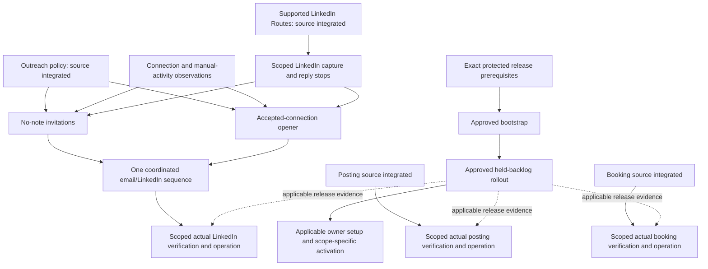

# Callie: conversation-first operating roadmap

## Destination and scope

Make David-only Callie useful for generating **new qualified property-manager conversations** through supported discovery and coordinated guarded email/LinkedIn, while CRM, Today and Ask preserve evidence and help David act. Posting supplies credibility; booking reduces friction after explicit agreement. David handles substantive sales replies and calls.

A connection, reply, qualified conversation, booking and attended call are different outcomes. A qualified conversation requires substantive two-way maintenance-workflow fit and interest, not merely an accepted connection or appointment. This roadmap promises supported product behavior and measured outcomes, not a customer-response quota or a fixed observation period.

Capture only the selected business Gmail scope. Phone, Messages, text, transcripts and files are explicitly selected imports, not background private scraping. Today stays action-focused, without a daily briefing. Original navigation, correction, source deletion, interruption/recovery and Disable must remain ordinary usable product paths.

This is the single low-resolution execution index. GitHub ticket bodies and accepted resolution comments remain the detailed contracts. [Conversation-first unattended execution readiness map](https://github.com/david-cui-bruno/founding-sales/issues/606) is the settled decision record, not an implementation backlog to reopen. [Current operating state](../../operations/current-state.md) owns dated source/deployed/provider observations. A gate or missing evidence belongs to its named execution ticket, not to an invented blanket prerequisite.

## Snapshot and status vocabulary

Inventory: October 14, 2026, 16:06 UTC, against source `7343e9567e38e7885b97786a3039726a5509d584` and GitHub bodies/comments/native dependency metadata. The tracker had **24 open issues**: four tracking parents and twenty execution/evidence outcomes. Source targets schema116. Posting/booking source integration and the release-workflow source repair are merged; merges do not attest actual provider operation or activation.

The last supported production readback was October 14 at 13:09 UTC: backend `d49dda37`, schema88, stable API2/worker1. This is a dated observation, not a new inspection performed while consolidating the roadmap. The release hold remains. The installed desktop observation remains dated; do not infer a current installed candidate.

| State | Meaning |
|---|---|
| Source integrated | Required behavior is in merged source; identify its checks/review evidence. |
| Controlled acceptance | Ordinary commands, workers, disposable PostgreSQL and controlled external adapters demonstrate behavior. |
| Actual evidence pending | Current provider/account/installed behavior or usefulness has not yet been observed for the applicable scope. |
| Approval gated | A precisely scoped real operation requires its separate owner approval. Planning and ticket creation do not supply it. |
| Operating | The approved scope is enabled, ordinary work/readback is observed, and Disable/revocation remains usable. |

A closed source ticket is not a deployed or operating capability. Conversely, an open operational ticket is not proof source code is absent. Two integrated source slices are still open in the tracker: [Manage and revoke a versioned standing LinkedIn posting policy](https://github.com/david-cui-bruno/founding-sales/issues/616) and [Run the guarded booking-only conversation lifecycle](https://github.com/david-cui-bruno/founding-sales/issues/624). Reconcile their acceptance against retained integration evidence, without reimplementing them or closing actual acceptance from source success.

## One complete outcome map

| Lane / finished user outcome | Canonical execution tickets | Current remaining work | Genuine gate / completion evidence |
|---|---|---|---|
| Supported prospect supply | [Recover supported canonical identities and residential/geography evidence](https://github.com/david-cui-bruno/founding-sales/issues/438); [Reproduce one retained prospect-loss case](https://github.com/david-cui-bruno/founding-sales/issues/604) | Recover complete existing original evidence, reproduce only supported failures, measure ordinary supported yield with denominators. | Missing historical arrays/selected original bindings must remain missing. The agreed one-off inspection approach is a separately approved operation, not permission to launch a task or dispatch new search. |
| Guarded verified-fit email | [Map disabled email readiness](https://github.com/david-cui-bruno/founding-sales/issues/605); [Release and conditionally activate verified-fit email admission](https://github.com/david-cui-bruno/founding-sales/issues/425) | Exact-build evaluation/sender/owner/sequence/control evidence, usable substantive-reply and booking handoff, then applicable release and approved operation. | A nominal read that writes is excluded from read-only diagnostics. Preserve cap5/lower caps/ramp, recipient-local weekday mornings, holds, original Shirley identity/cancelled follow-up and uncertain attempts. |
| LinkedIn connection/manual activity evidence | [Observe connection state and manual account activity](https://github.com/david-cui-bruno/founding-sales/issues/628) | Implement honest account-bound observation/coverage and prove which actual selected observations are available. | Unknown manual allowance or incomplete observation pauses the action. A fixture cannot prove current native capability. |
| LinkedIn business conversation/reply evidence | [Capture scoped LinkedIn conversations and stop prospecting on replies](https://github.com/david-cui-bruno/founding-sales/issues/629) | Supported private business capture, original identity/coverage, deletion, reply/refusal stop and David handoff. | Supported Routes are implemented. Actual selected native identity/history/coverage remains a feasibility/evidence gate, not a whole-inbox archive grant. |
| LinkedIn invitation and opener | [Send and reconcile no-note connection requests](https://github.com/david-cui-bruno/founding-sales/issues/630); [Send and reconcile an accepted-connection opener](https://github.com/david-cui-bruno/founding-sales/issues/631) | Ordinary action-specific runner/product journeys, native one-time markers, current authority and inspection-only uncertainty handling. | Both depend on observations and scoped conversation/reply capture. An opener on an already accepted connection does not depend on sending a new invitation. |
| Coordinated prospecting and scoped operation | [Run the coordinated invitation-to-conversation lifecycle](https://github.com/david-cui-bruno/founding-sales/issues/632); [Verify and activate scoped LinkedIn connections and DMs](https://github.com/david-cui-bruno/founding-sales/issues/633) | Shared person/firm/channel history and reservations, four combined touches, migration/conservation of manual/accepted/pending/unknown work, then actual calibrated content/native/stop/Enable/Disable evidence. | Never reset history by switching channels. Any reply stops automation. Native provider/account/release evidence is earned separately from source integration. |
| Credibility posting | [Manage and revoke a standing posting policy](https://github.com/david-cui-bruno/founding-sales/issues/616); [Verify and activate scoped recurring posting](https://github.com/david-cui-bruno/founding-sales/issues/618) | Reconcile integrated policy source acceptance; verify current account/provider/installed delivery and actual scoped operation. Grounded drafts and recurring journey source are closed. | Approved voice/content/account/data/spend scope, applicable release and separately approved actual acceptance. Posting identity/budget never grants outreach authority. |
| Agreed-call logistics | [Run the guarded booking-only conversation lifecycle](https://github.com/david-cui-bruno/founding-sales/issues/624); [Verify and activate scoped booking automation](https://github.com/david-cui-bruno/founding-sales/issues/625) | Reconcile integrated lifecycle acceptance; verify real calendar/event/sender/model/provider reminder and requested change/no-show outcomes for the actual scope. | Explicit agreement, verified attendee/availability, bounded logistics-only messages, current source/account/policy and uncertainty conservation. Unsupported channels/reminders remain held with reasons. |
| Ordinary business Gmail capture | [Verify ordinary business capture and recovery readiness](https://github.com/david-cui-bruno/founding-sales/issues/549) | Actual authorized ordinary capture, identity context, original navigation, interruption/recovery/coverage and deletion, sharing deployed setup evidence with activation. | Local selected-message diagnostic is not ordinary production capture. Business Gmail only; capture is not hosted processing, backfill or sending permission. |
| Progress, Today and human outcomes | [Evaluate conversation progress and actionable Today](https://github.com/david-cui-bruno/founding-sales/issues/550) | Separately measured deterministic activity and hosted interpretation, meaningful dated work, corrections and booking/opportunity/human-outcome journeys. | Preserve commercial stage versus outreach-control separation. Human attendance/qualification evidence is not inferred from elapsed time or model confidence. |
| Useful grounded Ask | [Evaluate Ask retrieval, grounded answers and responsiveness](https://github.com/david-cui-bruno/founding-sales/issues/551) | Actual configured ordinary-worker integration/usefulness, current exact SQL state, conversational history/scope, citations/conflict/ambiguity, cancellation/deletion/cost/latency. | Gemini LOW is the approved next route, not a new model-choice interview. Fixed-context results and synthetic success are not ordinary-worker or representative quality. Paid evaluation needs a fresh scoped allowance; consumed grants are not reusable. |
| Release and owner setup | [Activate independently verified CRM and Ask capabilities](https://github.com/david-cui-bruno/founding-sales/issues/552) | Complete exact backend/bootstrap prerequisites, reviewed held-backlog rollout, current configured adapters/consent, then independently passing owner scopes through normal Enable/readback/Disable. | Concrete production bundle approval, current backend access/encryption, serialized maintenance, actual release/health/record and scope-specific operation. No blanket social/native/Ask gate on passing backend scopes. |
| Native installed product | [LinkedIn native delivery acceptance](https://github.com/david-cui-bruno/founding-sales/issues/460); [Installed notification and reply-context acceptance](https://github.com/david-cui-bruno/founding-sales/issues/466) | Current installed schedule/inspect/cancel/restart/account-change proof, and notification/click/sleep-wake/reply context. | Exact installed build/account/test-action and required login/OS/physical-device checkpoints. Reuse only applicable evidence, not blanket parent closure. |

Tracking parents are [Autonomous verified-fit email admission](https://github.com/david-cui-bruno/founding-sales/issues/418), [Founder-sales roadmap](https://github.com/david-cui-bruno/founding-sales/issues/441), [Broader CRM and Ask](https://github.com/david-cui-bruno/founding-sales/issues/479), and [Capture/AI/Ask activation gates](https://github.com/david-cui-bruno/founding-sales/issues/497). They index the execution outcomes above; they are not four additional implementations or universal prerequisites.

## Dependency graph and independently takeable frontier

Solid edges are actual source/operational dependencies. Dotted release edges require applicable deployed evidence, not closure of every capability under setup. The graph does not put discovery/email, capture/progress/Ask, posting or booking behind completion of the whole LinkedIn lane.

**Take now, within source/planning authority:** connection/manual observations and scoped conversation/reply capture; retained prospect-loss/readiness preparation; applicable capture/progress/Ask integration/usefulness preparation; exact protected release prerequisite preparation. Reconcile the two source-integrated/open tracker slices against retained evidence rather than create duplicate work.

**Then:** invitations and accepted-connection opener independently after their shared observation/capture prerequisites; coordinated person-level prospecting after both; applicable actual evidence and scoped activation after their real source/setup gates. Existing accepted connections make the opener independently demoable.

### Milestones, not calendar promises

1. **Foundations and policy:** retain integrated source and settled decisions, reconcile the two source-integrated/open tickets against their actual acceptance contract.
2. **Unblocked evidence/source frontier:** supported prospect recovery/readiness; LinkedIn observations and reply capture; concrete progress/Ask regressions and applicable ordinary capture preparation. Advance independent lanes in parallel.
3. **Release prerequisites and held rollout:** complete the backend contract, separately approved bootstrap and separately approved backlog release. This delivers the applicable current build, not feature activation.
4. **Each capability's actual operation:** authorized provider/account/data/model/installed acceptance, normal owner setup/consent, scoped Enable, first ordinary operation and Disable. A failure holds only its affected scope.
5. **Useful monitored operation:** supported qualified-conversation funnel, original evidence and actionable work, grounded Ask, and agreed-call logistics. Keep measuring corrections and actual outcomes; no fixed customer-response or sample quota is introduced.

Two existing core tickets have concrete bounded next checks, not a new research program: progress evaluation must reproduce the retained conditional-offer output through the current claim/review/Today surface before calling it a definite promise; Ask evaluation must check current schema-wire/host refusal behavior and applicability of the existing frozen-source provider result after the intervening tool-description change. The actual Gemini ordinary-worker result exists, but is not exact-current-HEAD or representative proof. All prior paid diagnostic grants remain consumed.

## Release packaging under the existing activation owner

The October 14 preparation produced a private saved five-operation bootstrap plan and a separate additive trust proposal. Neither was applied. Independent review found that the existing deployment role explicitly denies Terraform backend object reads; adding workflow trust alone does not make reviewed deployment executable. Local preparation used a distinct backend actor and a KMS override while the reviewed workflow initializes without that override. These are concrete prerequisites, not a new generic infrastructure program.

The [bounded primary-source backend research](../../sourcing/release-backend-roadmap-research-20261014.md) recommends preserving the observed AES256 backend behavior and naming exact backend versus provider credentials and state/lock/checksum rights. An allow does not override the existing explicit deny, and a KMS-encrypted lock needs write-side KMS permissions even for a state-read-only planner. The recommendation is not approval to change encryption, role permissions, trust or live configuration. Settle the reproducible source contract first; live effective rights and the actual encryption path require separately authorized readback/application.

Proposed packaging, **pending approval of ticket granularity**; until publication these remain owned by the existing activation ticket:

1. **Make reviewed release backend access and encryption explicit.** A narrow source/proposal/controlled-proof slice: exact existing-role deny treatment and minimum backend permissions, one consistent encryption contract across actors/stages, preserved unrelated policy/trust, current-toolchain and ordinary CLI fail-closed tests. No live IAM change or application is part of source completion.
2. **Bootstrap the protected production release prerequisites.** Blocked by the backend contract. Fresh exact plan plus separately reviewed full trust/permission and GitHub environment/key-binding documents; explicit application approval; scoped application and current readback; current running application and release/sending holds unchanged. No blanket deployment template replacement, state surgery or silently copied permissions.
3. **Roll out the held backlog through the reviewed release path.** Blocked by bootstrap. Freeze applicable current candidate/images/deployed-baseline upgrade/migration classification/backup/maintenance/recovery plan; obtain concrete rollout approval; execute and verify actual build/schema/health/release status through the supported serialized procedure. Deployment preserves valid owner settings and is not capability Enable.

The previously selected **one-off prospect evidence inspection** stays under its existing activation/preparation owners and [approved transport decision](https://github.com/david-cui-bruno/founding-sales/issues/636). Do not publish the rejected reusable inspection-tool alternative. Exact operation/policy-exception approval, current bindings, private transfer and cleanup are still required before launch.

## Settled decisions and completed planning

Consume these decisions, do not repeat their interviews:

- [Standing unattended operating agreement](https://github.com/david-cui-bruno/founding-sales/issues/607): all eight existing outcomes, conversation-first priority, ticket-scoped engineering, genuine read-only access and explicit protected operational checkpoints. Later explicit approval boundaries remain in force.
- [Standing posting policy](https://github.com/david-cui-bruno/founding-sales/issues/608): original calibrated LinkedIn-only text/voice and factual inputs; Tuesday/Thursday10AM New York, two weekly/no catch-up; separate $1/day/$10-calendar-month ceiling within stricter shared limits.
- [Standing booking/logistics policy](https://github.com/david-cui-bruno/founding-sales/issues/609):20-minute intro plus10-minute buffer, approved weekday/time/notice/horizon rules, no call-count cap, explicit agreement, narrow logistics and requested changes, manual no-show confirmation, separate $2/day/$25-calendar-month ceiling within stricter limits.
- [Remaining LinkedIn runtime policy](https://github.com/david-cui-bruno/founding-sales/issues/634): no-note invitations, rolling20/24h and140/7d including manual activity; DM20/24h weekdays; approved prospect-local windows; one Person/firm and30-day unanswered cooldown; four combined messages; scoped business retention/deletion; initial Haiku4.5 route and separate $2/day/$25-calendar-month generation ceiling; one-time original voice calibration before operation.
- [Vertex Ask capability contract](https://github.com/david-cui-bruno/founding-sales/issues/610): preserve conversational synthesis/conflict/ambiguity and correct grounding; do not silently narrow to quote-only answers.
- [Discovery/email evidence recovery](https://github.com/david-cui-bruno/founding-sales/issues/635) and [inspection transport](https://github.com/david-cui-bruno/founding-sales/issues/636): conditional historical recovery and the one-off packet, not an assumed parser defect or reusable-tool program.

Public LinkedIn workflow/cadence/voice and call-duration research is retained through the decision map. It does not establish a general optimum, actual current account coverage or representative provider quality. The next research is only a precise fact needed by an existing ticket or the demonstrated backend prerequisite.

## Codebase design contract

Keep the existing stack, PostgreSQL jobs, versioned original evidence, SQL exact state and bounded hybrid retrieval. AI SDK owns provider integration; host modules own access, lifetime, cancellation and spending. Reuse ordinary authenticated command/readback -> registered worker -> current authority/source -> controlled adapter seams, then earn actual provider evidence separately.

One integrator owns shared schema/contracts/access/deletion/lock ordering and combined verification. Action-specific native observation/invitation/DM adapters are not a generic social platform framework. Posting identity is not outreach identity; a reply is not qualification or booking agreement; technical Route support is not sending permission.

The coordinated prospecting ticket already owns the shared Person/firm/channel reservation and migration contract. Its proof must conserve legacy email/manual/accepted/pending/unknown history, stop on replies/refusals, prevent a channel switch from restarting four-touch capacity, and preserve owner-visible outcomes after real PostgreSQL races/restart. Resolve implementation ownership at that existing seam, not through an unrelated architecture ticket.

Design only where a current caller exposes a missing interface or concrete test cannot be represented. Optional ANN/vector/reranking, a permanent staging platform, zero-downtime migration architecture and generic approval frameworks are not initial-roadmap gates without an observed need.

## What cannot be earned through planning alone

Current LinkedIn identity/layout/manual-count/reply observation feasibility, real provider/usefulness, exact account/OAuth/data/model/recurring-scope bindings, installed physical-device behavior and actual release/Enable outcomes need their named operational evidence. They are explicit ticketed checks, not hidden decisions or permission to fabricate positive observations. When a critical check fails, stop only that scope and ticket the demonstrated failure; continue safe independent work.

David supplies genuine owner choices, account consent, concrete protected operation approvals and required interactive/physical-device steps. Codex prepares exact packets, implements/tests/reviews source, verifies delegated product/worker/UI outcomes and reports limitations. Do not ask David to coordinate internal receipts or reapprove unchanged policy for every ordinary release.

## Completion and execution discipline

A lane is complete when its own acceptance contract is met and evidence identifies source/control/provider/deployed/enabled/usefulness states truthfully. The initial destination is reached when the approved David-only scopes are independently usable, supported prospecting produces observable durable actions/handoffs, relevant business context and dated work are useful, and agreed-call logistics operate within their actual verified scope. Customer response quotas and broader commercial rollout are not engineering completion gates.

For each implementation ticket: declare genuine native blockers, use ordinary caller/registered-worker TDD with real disposable PostgreSQL and controlled external adapters, keep a complete demoable vertical slice, run applicable current checks/exact-head CI, then independent Spec/Standards reviews plus a risk specialist where needed. Actual provider/release/activation tickets close only from their applicable actual outcomes, never from planning or green source CI.

Keep all existing sending safeguards and current holds. The retained control posture has admission, routine replies and autonomous calling OFF, with uncertain attempts held and Shirley's original identity/cancelled follow-up preserved; this is not a freshly inspected setting. No roadmap publication grants release/deploy/Enable, actual sends/bookings/posts, paid provider runs, account changes, unrelated private acquisition, arbitrary new platforms, autonomous calls/sales negotiations, blind resubmission or increased budgets. Monitored David-only provisional quality remains distinct from representative reliability; keep reviewing useful outputs and corrections during operation without imposing a new fixed sample/customer quota.

[Retained roadmap decisions and dated checkpoints](roadmap-history-20261011.md) remain history. The October11 Ask-first priority is superseded by the settled conversation-first destination, not erased.
