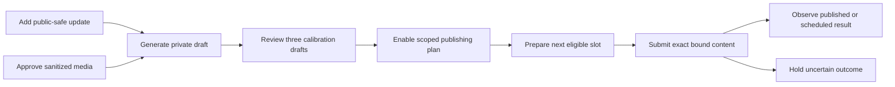

# Founder-voice Social: private inputs to automatic publication

Parent: #783. Implementation: #925. **Agreed specification; software deployed, genuine owner activation pending.** [Current state](../operations/current-state.md) owns production acceptance and controls. David confirmed the brief in the November3 interview. This document authorizes no account action, photo access, model call or publication.

## Outcome and agreed scope

Build David's personal brand as a college founder building AI products. Broad founder/AI/college-builder attention is useful independently of immediate property-manager demos. Callie supplies real material, not a compulsory sales pitch or an industry-expert persona.

[Pavan Kumar of Clean](social-reference-pavan-kumar-20261103.md) is the stronger reference; [Ayaan Gazali](social-reference-ayaan-gazali-20261103.md) is secondary. Transfer clear first-person openings, concrete progress, short readable passages and human detail—not distinctive wording, biography, credentials, customer claims or purported growth formulas. Rotate real stories/progress, genuine AI/startup opinions, practical technical insight and humor/college life. Do not force all four into each post, a numbered daily series or a CTA into every ending.

- Personal LinkedIn profile first; text or text plus one real photo/screenshot. Reuse the settled single-image route, not a new social platform. Preserve accepted source image types, including HEIC conversion; final publishable images are JPEG/PNG.
- Three managed posts per owner-local calendar week. Proposed editable default: Monday/Wednesday/Friday10:00, America/New_York. Timing is an operating default, not a claim of optimal reach.
- Rough real bullets from David; three private calibration drafts he reviews/corrects, then standing-policy automation without permanent per-post approvals.
- An explicitly approved media pool may supply images automatically. David offered broader photo access but expects little benefit; whole-library access is not a dependency and never makes every photo publishable. No library enumeration/import is part of this implementation.
- Use current approved backlog when fresh material is thin; otherwise skip visibly. Never invent experiences, beliefs, wins, numbers, customer stories, endorsements or urgency to fill a slot.
- No automatic comments, DMs, invitations, unsolicited tagging, keyword-response promises, public-thread acquisition, cross-posting, generated proof images or new paid service. Video/carousel routes are not implied by the existing single-photo capability.

## Implemented owners and readiness boundaries

| Existing owner | Implemented behavior and boundary |
| --- | --- |
| [Private guide](../../packages/domain/social/voicePreferences.ts), [guide lifecycle](../../packages/domain/social/voiceGeneration.ts), [ADR0022](../adr/0022-private-social-voice-preferences.md) | Owner-private bounded current style entries; not facts, a training corpus or consent for background processing. Guide edits currently erase dependent suggestions and corrected private drafts. |
| [Private drafts](../../packages/domain/social/privateDrafts.ts), [source basis](../../packages/domain/social/privateDraftSources.ts), [ADR0021](../adr/0021-durable-private-social-composition.md) | Current-text CAS composition, sticky lineage and fixed90-day maximum. Not factual approval, a publication queue or a photo selection model. |
| [Workspace facts](../../packages/domain/outreach/facts.ts) | Approved outreach blocks are workspace-level and preserve versions. Do not put private founder notes here or treat a private composition as approved evidence. |
| [Founder inputs/calibration](../../packages/domain/social/founderInputs.ts) | Owner-private current bullets, explicit public-use eligibility and three distinct private-draft reviews. Calibration does not activate publication or prove genuine voice quality. |
| [Generation](../../packages/domain/social/draftRun.ts), [source resolver](../../packages/domain/social/draftSources.ts), [real adapter](../../apps/worker/src/social/draftModel.ts) | Governed Bedrock/Haiku generation with current source/guide checks, reservations and uncertainty. Scheduled generation additionally requires the explicit current standing grant; a click-scoped request is not that grant. |
| [Assets](../../packages/domain/social/assets.ts), [approved media](../../packages/domain/social/approvedMedia.ts), [storage](../../apps/api/src/social/mediaStore.ts), [cleanup](../../apps/worker/src/social/cleanup.ts) | Browser upload, decoded-image validation, sanitization, preview, public-use approval and owner/lifecycle erasure use the existing asset owner. Upload alone never grants public use or whole-library access. |
| [Posts](../../packages/domain/social/posts.ts), [delivery](../../packages/domain/social/delivery.ts), [standing jobs](../../apps/worker/src/social/standingJobs.ts) | Manual revision/approval and guarded system-worker publication share durable submission/history owners. Current owner/account/plan bindings replace the unused hardcoded worker snapshot; UNKNOWN never permits another create. |
| [Readiness](../../packages/domain/social/publishingReadiness.ts), [retired work](../../packages/domain/social/retiredPosting.ts) | Fresh API/worker runtime observation, current intended-account verification and explicit plan prerequisites are separate. Historical cadence rows, private drafts and connected markers remain insufficient authority. |

## User journey

### 1. Owner-private public-safe inputs

Add a distinct owner-private Social input owner; do not overload style entries, shared CRM/outreach facts, private post compositions or public-thread snapshots. An input contains bounded current bullets, optional experience date, topic/stance context, revision and explicit public-use eligibility. Use the existing private-composition text/byte ceilings as upper bounds, current-content CAS and no prose revision history. Default private input lifetime is at most90days from first save, not renewed by edits.

The author can save rough/private material or deliberately choose **Use for my posts**. That choice authorizes the supplied current content as public-safe source material within the selected plan; it is not independent verification of its truth and does not instantly publish it. The interface explains generation/publication purpose. No inferred approval from an upload, an ordinary draft save, camera-roll access or an old sanitized flag. Removal clears prose and establishes a terminal revision fence.

Bind personal experience and first-person opinions to what David actually supplied. A style preference for strong opinions cannot invent a specific belief. Product capabilities/metrics retain current approved factual support and truthful planned/local/shipped distinctions. Public research can verify a claim only through its separately authorized source owner; no new news collector, inbox/call mining or implicit source import is included.

Extend source resolution, fingerprints, current reads and lineage through private drafts and eventual publishing posts together. Source edits/removal/expiry or owner loss invalidate unsubmitted dependent output and physically clear private/queued prose under the applicable lifecycle; never renew a source deadline during adoption. Submitted/published/unknown history retains only the minimum operational evidence, not a path to reconstruct withdrawn source text.

### 2. Approved real-image pool

Extend the existing Social asset/storage/deletion owners and narrow browser transport, including private object-store CORS where direct upload requires it. Do not add a photo-library service or reuse meeting-audio authorization.

- Accept existing supported source types/20MiB encoded ceiling; validate actual bytes, not MIME/checksum declarations. Bound decoding to36million source pixels and one still image; reject malformed, animated or mismatched files before expensive work. Handle orientation before stripping metadata.
- Quarantine originals privately for sanitization only; never mark them publishable or expose them as post downloads. Delete them after sanitized completion/failure, with a24-hour maximum and existing signed-URL expiry grace. Durable cleanup must cover abandoned/crashed processing as well as pending uploads. Existing unrelated historical assets are not silently swept by this new rule.
- Produce one validated JPEG/PNG derivative, at most5MiB and4096pixels per edge; compute final dimensions/digest server-side. Strip EXIF/GPS and unnecessary metadata. No promise that automatic scanning proves visible content is public-safe.
- David approves the exact sanitized preview/version for the pool, optionally in a batch, with a caption/topic and accurate alt text. He must have rights to share it. Sensitive visible people, credentials, customer/tenant information and addresses must not enter the pool without explicit public-use clearance. Pose/date/location are not inferred from a photo as if it were a current event.
- Selection uses approved captions/topic metadata; no new vision-model upload or camera-roll analysis is implied. Missing useful media yields text-only content, not a random or generated image. An explicitly image-required candidate remains held if its selected asset disappears.
- Private draft/candidate and approval bind the exact sanitized asset version/digest/alt text. A newer derivative is not an authorized replacement. Withdrawal blocks new submissions immediately; owner departure/removal and source lifecycle must queue physical object erasure, respecting outstanding signed-URL grace and quota accounting.
- Local pool deletion does not delete a remote post/image. Preserve minimal receipt/native identity/no-repeat evidence; remote deletion is a separate authorized action. Preserve the settled native acceptance rule: exact account/text/time, image count and loaded saved preview; do not reintroduce an original-byte-to-native-ID proof requirement.

### 3. Three-draft calibration, not implicit training

Use three ordinary private drafts generated through three bounded existing-style requests, one concept each. Choose distinct relevant formats from the agreed mix and actual inputs. David reviews each and corrects it if necessary; requiring a cosmetic edit is not a completion condition. Completion means he accepts the voice, factual accuracy and willingness to publish those exact current revisions privately; it does not publish them.

Store only minimal owner-scoped calibration identities/revisions and completion metadata, not a before/after corpus, copied examples, private prose history or automatic learning from edits. Corrections replace current draft text through ordinary CAS and do not silently call a model or rewrite the guide.

Resolve existing guide erasure deliberately: inspect/accept the three current corrections first; David may explicitly curate final style instructions, then complete calibration atomically against the exact reviewed revisions and resulting guide revision. Existing guide-change erasure still runs; keep no hidden copy of the erased examples. Completion is historical voice acceptance, not a requirement to keep example prose readable forever or a fresh posting grant. Later input expiry does not reopen this interview. Future guide changes invalidate unsubmitted dependent output; applying a changed guide to the standing plan requires an explicit owner plan revision, not silent background opt-in. Further private previews remain available without making every post a review task.

## Standing policy, scheduling and publication

### Explicit authority and a real publisher

A current owner plan binds owner/workspace, verified personal account identity/revision, supported runner/adapter, guide revision, eligible private-input scope, approved-media scope, cadence/timezone, existing model/budget scope and pause/revocation state. Provide distinct disclosed scopes for **scheduled generation** and **publication**; they may be enabled together in one clear activation action after calibration. Saving/selecting a guide or the existing `bedrock_haiku_private_draft_v1` click marker is not either grant. Revisions/receipts/audit contain opaque bindings, not copied guide/note/photo contents.

Use the already-approved [LinkedIn browser route](linkedin-policy.md) and implement a real web-owned publisher connection/runtime within the existing stack. Do not revive Electron/desktop under [ADR0027](../adr/0027-web-product.md), copy Codex's signed-in session/cookies, or pretend an account marker/adapter constant proves connectivity. Normal owner connection must independently read back the intended account, actual supported submit/inspect/cancel capability and current usable session. A missing runner is an implementation gap, not permission to return fake success or replace the agreed workflow with manual-only posting.

[Official API research](social-linkedin-publication-options-20261103.md) records a possible alternative, not the chosen shortcut: self-service write scope does not prove unattended API rights, image-status reads or own-post reconciliation. Those API-specific terms/entitlements do not reopen the accepted browser permission. Any future API selection needs its own supported authority/readiness/reconciliation contract before activation.

Keep worker actors as system workers with durable owner/account/plan bindings. Never synthesize David's user/device/session to invoke a user-only approval route. Strengthen reused browser commands with the current-principal-after-wait/receipt-replay fences already used by private workflows; legacy manual route authentication alone is insufficient. Supersede only the necessary ADR0020/21/22 exclusions explicitly in the implementation decision; preserve private current-only storage, consent, lifecycle and no-impersonation invariants. Never revive historical recurring approvals, retired candidate bindings or outreach-consent records as publication authority.

### Slot and attempt semantics

Use the existing PostgreSQL job/scheduler and Social budget/reservation owners. No new queue, auth system or posting SaaS. Keep the existing Social100cent/day,1000cent/month and shared applicable ceilings; no higher spend or automatic paid retry follows from three posts/week.

1. Uniquely bind each managed slot to owner/channel/local calendar week and target instant independently of plan revision. Three managed slots/week maximum; editing policy, reconnecting, restarting or changing a slot cannot reset admission/attempt history. A confirmed published post and an uncertain submission consume their slot. Do not claim complete observation of posts made outside the product.
2. Select an eligible unconsumed update/backlog item and optional matching approved image. Bind exact source/guide/input/asset/account/plan revisions before generation and handoff. Track a consumed lineage so the same story is not silently recycled as a fresh win. If nothing suitable exists, record skipped/no-material; no fabricated filler or catch-up burst.
3. Revalidate owner membership, active processing/publication scopes, holds, budget/reservations, source deadlines, approved media, account and current plan after waits and immediately before each model/provider handoff. Establish an egress fence ordered with pause/revocation so a committed stop blocks new handoffs; already in-flight uncertainty remains visible.
4. Preserve one durable submission identity before the first possible external write. Worker restart/lease expiry, account switch, timeout, empty list, source withdrawal or a missing receipt never authorizes another create. Distinguish preparation known not submitted from a potentially submitted attempt. Inspect/reconcile the latter, never blindly repost.
5. Reuse native future scheduling where the real route supports it, with account/text/time/image-count/loaded-preview readback. A confirmed remote schedule is scheduled—not published. Publication-time inspection must establish the eventual result. The UI must work truthfully when the app closes; runner/session availability and remote scheduling are separate states.
6. Pause stops new generation/admission/submissions. Queued-but-unsubmitted slots are cancelled locally. Activation discloses whether the plan also authorizes cancellation of its own future remote schedules; the stop path requests those cancellations and tracks them until confirmed. Pause is not a claim that already-accepted remote work vanished. Publication can win a cancellation race. Disconnect/session loss leaves remote schedules/cancellation uncertainty visible, never reset as absent.
7. Missed preparation/publication windows are skipped or visibly held for deliberate rescheduling, never burst after restart. Skipped/known-not-submitted slots do not create hidden extra weekly slots. No per-post approval is required for eligible work under a current activated policy; exceptions remain held with actionable reasons.

### Visible product surface

Social owns **Updates**, **Media**, **Calibration**, **Plan** and **Activity** within the existing workspace, not five new top-level destinations. Show current source eligibility, public-use designation, selected image preview/alt text, remaining managed weekly slots and exact account/timezone.

The owner can preview/edit/skip queued content, revise/pause the plan and inspect real outcomes. Before submission, edits invalidate the old candidate and revalidate its source/plan basis. Submitted/scheduled/unknown content cannot be silently edited/replaced; use current cancellation/inspection semantics. Changing an image requires its own current approved version. Never detach generated lineage by copying to a manual draft.

Activity distinguishes private, eligible, queued/preparing, skipped, held, submitting, scheduled, published, cancellation-pending, cancelled, failed-known-not-submitted and unknown. Show a permalink only when observed/returned by the supported route; a click, upload acknowledgement or schedule receipt is not published proof. Explain the next action for missing material, rejected media, expired account, changed source/guide/policy, budget hold, failed cancellation and uncertain submission. No private notes/guide/photo bytes in URLs, browser persistence, receipts, logs or technical telemetry.

## Finite implementation outcomes and acceptance

| Slice | Observable completion |
| --- | --- |
| **4.2a — Inputs and calibration** | Owner-private public-safe notes feed governed generation; three actual private drafts can be corrected/accepted, guide-change erasure is handled without hidden copies, and calibration does not grant publishing. No creator-post import or auto-training. |
| **4.2b — Approved media** | Actual browser upload/validation/sanitization/preview/approval/removal works through the Social asset owner; normal JPEG/PNG/WebP/HEIC photos produce supported derivatives. No original metadata in publishable bytes, immutable approvals and owner/lifecycle erasure. |
| **4.3a — Real web-owned publisher** | Implemented account-bound runner, real normal connection and independent submit/inspect/cancel paths; readiness derives actual capability, never a config flag. No desktop revival, borrowed session or new generic browser service. Source acceptance remains zero-outbound. |
| **4.3b — Standing plan and lifecycle** | Explicit delegated generation/publication policy,3/week slot uniqueness, existing paid accounting, source-to-publication lineage, pause/revocation fences, no-repeat/UNKNOWN and image-capable handoff work across restart. Historical recurring authority remains inert. |
| **4.3c — Integrated browser and activation** | Current signed browser journey handles updates→media→calibration→plan→activity and all truthful holds. Proportional reviews/CI/release/normal readback pass before scoped activation. Actual usefulness/account/calibration is not inferred from source fixtures. |

Permanent tests must cover plausible consumer failures: cross-owner notes/history leaks; stale CAS and lost-response custody; private-input source loss through queued posts; revoked session/owner/plan across real waits; malformed/fake-MIME/decoded-size images and final GPS/EXIF absence; HEIC orientation; stale media approval/removal/departure; three-draft finish racing guide erasure; system-actor delegation; midnight/week/DST and plan-edit duplicate slots; budget/UNKNOWN accounting; concurrent workers and crash around marker; missed-slot/no-catch-up behavior; pause/cancel/publication races and nonreplacement after uncertain results. Extend the existing private-draft, generation, asset and delivery behavioral suites; remove obsolete-only recurring/source-text assertions rather than repin them.

Use actual signed browser/API/app_runtime/Postgres acceptance with fictional public-safe notes and owned image fixtures. Prove real storage normalization/deletion and model/publisher seams with controlled ports; no prospect-visible post, real upload or far-future schedule is an engineering test without its own scoped instruction. Before a real write, normal owner account connection, working route, three genuine calibration drafts, exact live plan/content/media/cadence scope and current readiness must pass. Generic browser permission is already settled; do not requalify it. If a bounded schedule/cancel test is separately approved, preserve its exact account/content/time and unknown-write/cancellation custody; it does not prove public publication. Later observe the authorized ordinary post and actual permalink/readback, not a fabricated success.

## Delivery and boundaries

Root owns contracts/schema/routes/integration/production and finite tickets. Reuse current private guide/draft, Social asset, governed model, PG scheduler and submission/history modules; add only the missing private-input/calibration/current-plan/runner seams. Keep manual composition/ledger and historical no-repeat evidence. Migrations are the next reviewed contiguous schema change at implementation, with normal privileges, source-loss/owner lifecycle and upgrade checks—not a reserved guessed schema number here.

This specifies the complete agreed loop. Software delivery and operational evidence belong to [current state](../operations/current-state.md); real bullets, supplied media, genuine calibration and intended-account/plan activation remain normal-product owner inputs. Fixtures prove neither voice quality nor public publication. Public Conversations remain roadmap4.4, outside this feature. Email's bounded25-company/5-per-day/no-follow-up campaign, Gmail scope and newer stops remain independent.
